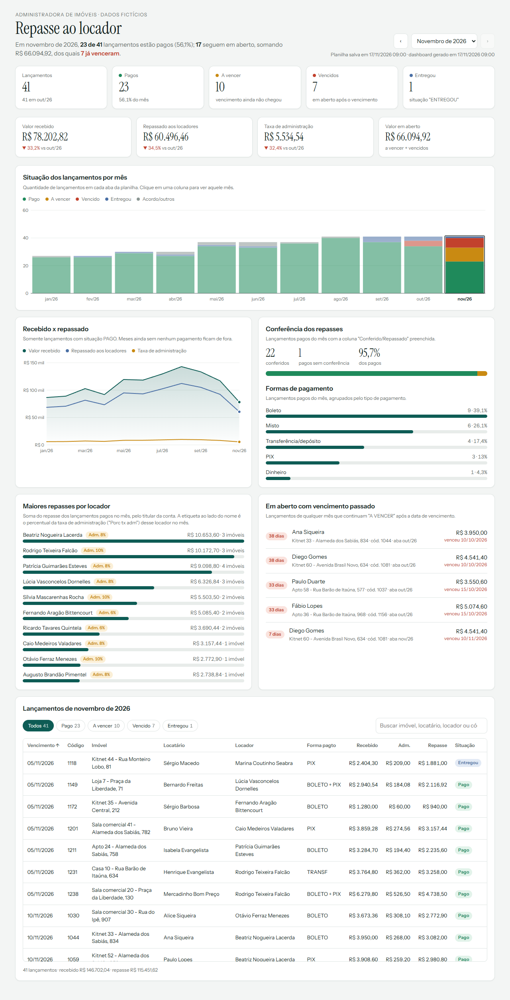
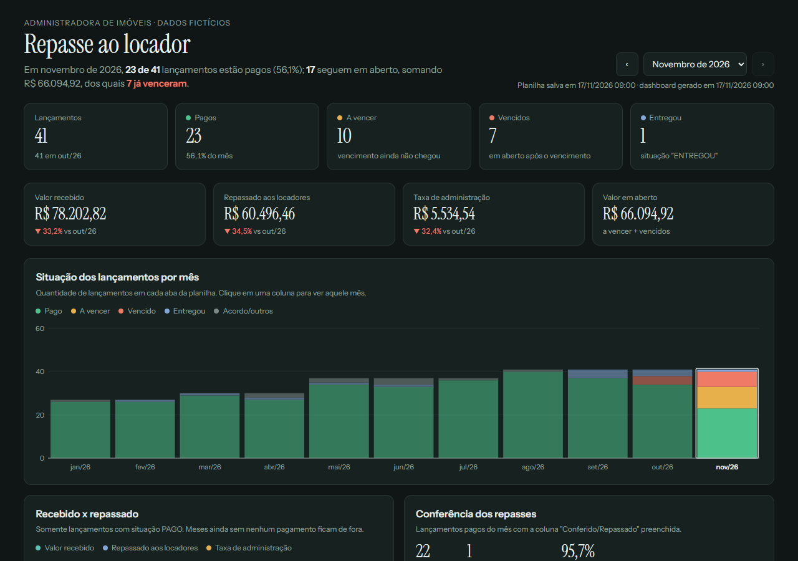
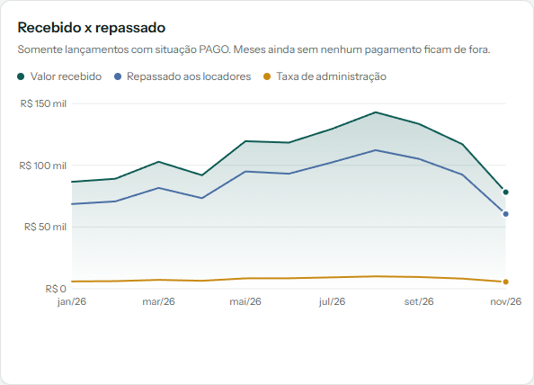
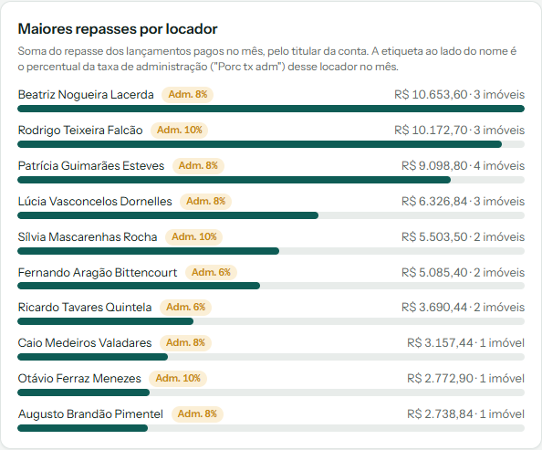

# Dashboard interativo

Dashboard de repasse a locadores, em **um único arquivo HTML**, que transforma a planilha mensal de uma administradora de
imóveis em indicadores: quantos aluguéis foram pagos, quantos estão a vencer ou vencidos, quanto foi recebido,
quanto vai para cada proprietário (locador) e quanto fica de taxa de administração.

Projeto pessoal, feito a partir de uma necessidade real do dia a dia: acompanhar os repasses sem precisar
filtrar abas de Excel na mão. Nesta versão pública, **todos os dados são fictícios** (nomes, endereços e valores
inventados por um gerador).

<p>
  
  
</p>

## O que o dashboard mostra

- **Seletor de mês** (e setas) com o resumo do mês em uma frase: quantos pagos, quantos em aberto, quanto
  está vencido.
- **Indicadores de quantidade** (lançamentos, pagos, a vencer, vencidos, entregou) e **de valor** (recebido,
  repassado aos locadores, taxa de administração, em aberto), com a variação em relação ao mês anterior.
- **Situação por mês:** gráfico de colunas empilhadas; clicar em uma coluna abre aquele mês.
- **Recebido x repassado:** evolução mensal, com dica ao passar o mouse.
- **Conferência dos repasses** e **formas de pagamento** (boleto, PIX, dinheiro, misto...), agrupadas a partir
  de um texto livre da planilha.
- **Maiores repasses por locador**, com a taxa de administração de cada um.
- **Em aberto com vencimento passado:** lista de qualquer mês, com os dias de atraso.
- **Tabela de lançamentos** com filtro por situação, busca e ordenação por coluna.
- Tema **claro e escuro** automático e layout que funciona no celular.

<p>
  
  
  
</p>

## Como funciona

```
planilha .xlsx (uma aba por mês)  ->  gerar_dashboard.py  ->  dashboard.html (dados embutidos)
```

1. `gerar_dashboard.py` lê todas as abas cujo nome é "MÊS ANO" (ex.: `JANEIRO 2026`), localiza as colunas pelo
   título (sem diferenciar acento ou maiúscula), converte valores e datas e agrupa as formas de pagamento.
2. Os lançamentos são gravados como JSON dentro de `modelo.html`, e o resultado é o `dashboard.html`.
3. O HTML desenha tudo no navegador, com JavaScript puro e SVG feito à mão (sem bibliotecas de gráfico).
   Não precisa de servidor nem de internet, exceto para carregar a fonte do Google Fonts (há fontes de reserva).

Detalhes de regra: um lançamento "A VENCER" cujo vencimento já passou é exibido como **Vencido**; a taxa de
administração vem da coluna "PORC TX ADM"; o repasse é o aluguel líquido menos a taxa.

## Ver o exemplo

O arquivo **`dashboard.html`** já está pronto: baixe o repositório e abra-o no navegador. Para a demonstração, o
"hoje" é fixo em 17/11/2026, então o exemplo não muda com o tempo.

Para gerar tudo de novo (Windows), baixe para uma pasta de caminho curto, como `C:\projetos` (botão
**Code → Download ZIP** ou `git clone https://github.com/Moura1106/dashboard-interativo.git C:\projetos\dashboard-interativo`)
e dê dois cliques em **`iniciar_demo.bat`**. Precisa do [Python 3.10+](https://www.python.org/downloads/)
(marque "Add python.exe to PATH"). Ou, passo a passo:

```powershell
python -m venv .venv
.\.venv\Scripts\pip install -r requirements.txt
.\.venv\Scripts\python gerar_planilha_demo.py     # cria exemplo/lancamentos_demo.xlsx (dados inventados)
.\.venv\Scripts\python gerar_dashboard.py         # cria dashboard.html
```

No Linux/macOS, troque `.\.venv\Scripts\` por `.venv/bin/`.

### Usar com outra planilha

```powershell
.\.venv\Scripts\python gerar_dashboard.py caminho\da\planilha.xlsx
```

Gera `dashboard_real.html`, que o `.gitignore` deixa de fora do Git. A planilha precisa ter as colunas
`CODIGO, IMOVEL, LOCATARIO, VENCIMENTO, FORMA PAGTO, VALOR RECEBIDO, VALOR LIQUIDO ALUGUEL, IPTU,
SEGURO INCENDIO, CONDOMINIO, PORC TX ADM, VALOR ADM, REPASSE LOCADOR, TITULAR CONTA, CONFERIDO/REPASSADO,
SITUACAO`. Veja o exemplo em `exemplo/lancamentos_demo.xlsx`.

> O dashboard embute todos os dados no HTML. Se você gerar um com dados reais, trate o arquivo como
> confidencial e não o publique.

## Testes

```powershell
.\.venv\Scripts\python -m pytest tests -v
```

Cobrem a leitura das abas, a conversão de valores e taxas, o agrupamento das formas de pagamento, o gerador
determinístico e o HTML publicado.

## Estrutura

| Arquivo | Para que serve |
|---|---|
| `gerar_planilha_demo.py` | Cria a planilha fictícia (12 locadores, ~35 imóveis, 11 meses, semente fixa) |
| `gerar_dashboard.py` | Lê a planilha e gera o HTML |
| `modelo.html` | Página com CSS, JavaScript e gráficos em SVG |
| `dashboard.html` | Exemplo pronto, com os dados fictícios |
| `exemplo/lancamentos_demo.xlsx` | Planilha fictícia no formato esperado |
| `tests/` | Testes automatizados |

## Limitações

- É uma ferramenta de leitura: não grava nada na planilha.
- O formato da planilha (nomes das colunas e das abas) é fixo; outro layout exige ajustar `COLS` em
  `gerar_dashboard.py`.
- O dashboard precisa ser gerado de novo quando a planilha muda.

## Licença

[MIT](LICENSE)
